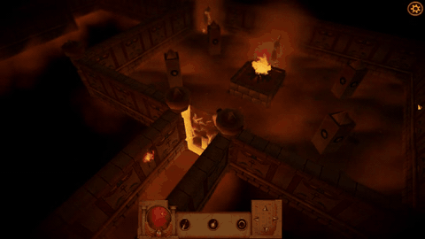
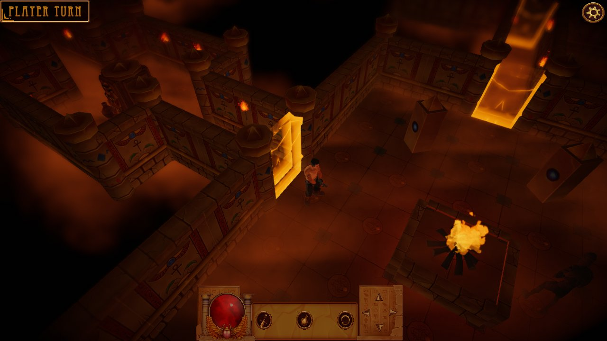
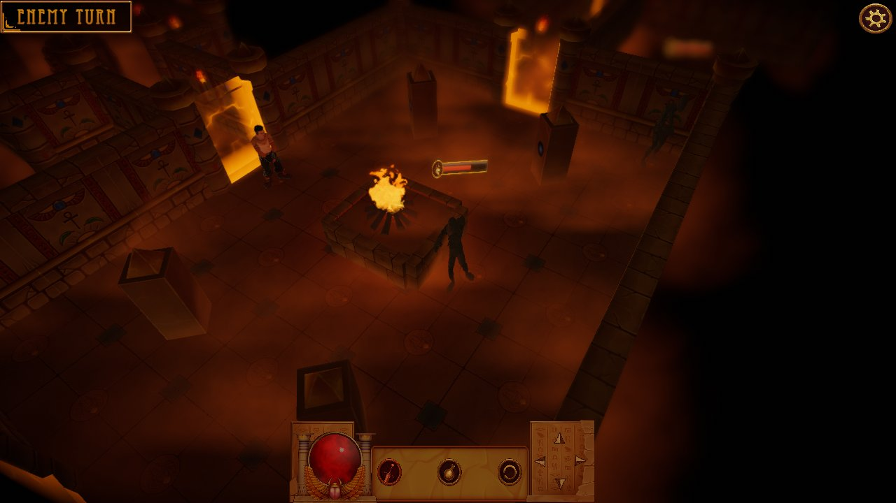

# The Descent

A turn-based dungeon crawler made in Unity as a university project. You explore a
procedurally generated Egyptian tomb; walking into certain rooms seals the doors
and raises mummies, and the fight plays out turn by turn on the room's tile grid.



| | |
|---|---|
|  |  |

## What's in it

**Runtime level generation.** Each run assembles the tomb from room and corridor
prefabs ("sections"). Every section declares its exits, a bounding collider and
tags saying which kinds of section may attach to it. The generator grows the level
outward from the spawn room, rejects candidates that would overlap existing ones,
and caps unused exits with dead ends. Generation is seeded, so a layout can be
reproduced. The section/exit/tag core (`Scripts/LevelGenerator`, `Structure`,
`Helpers`, `Exceptions`) is adapted from the free *Procedural Level Generator*
package on the Unity Asset Store. On top of it I added a walkable tile grid per
room, enemy spawn chances, transfer tiles that link one room's exit to the next
room's entrance, and per-room orientation, so that screen-relative input maps
onto each room's grid (`MapManager`).

**Turn-based combat.** Entering an uncleared room locks it and spawns mummies
(`TurnManager`). Player and enemies then alternate turns: the player moves, shoots
along a row or column at the first mummy in line, or drinks a potion. Each mummy
in turn walks toward the player, or attacks if it's adjacent, while the camera
follows whoever is acting. Spawning and dying play a dissolve effect, done by
tweening a dissolve shader's parameter with DOTween.

## Third-party assets (not included)

The art, audio and some plugins come from the Unity Asset Store and other sources
whose licences don't allow redistribution, so they're excluded from this
repository. Without them the code still compiles (once DOTween is imported), but
most models, effects and UI will be missing. To see the game as intended, import
the following into the folders listed:

| Folder under `Assets/` | What it provides |
|---|---|
| `Plugins/Demigiant/DOTween` | **DOTween** (free; Asset Store or dotween.demigiant.com). Required to compile. |
| `TextMesh Pro` | TMP Essential Resources (Window > TextMeshPro > Import TMP Essential Resources) |
| `Egypt_UI` | Menu and HUD art |
| `MedievalTombEgypt` | Tomb walls, floors and props |
| `PortalsPackage` | The glowing gates that seal a room during a battle |
| `Dissolve`, `DissolveEmissionShader` | The mummies' spawn and death dissolve |
| `Sand Effects pack` | Sandstorm particles |
| `Cartoon Fire Particles` | Torches and braziers |
| `Low Poly Guns`, `Low-Poly Weapons` | The player's pistol |
| `AS_Casual_Island_Game_Sounds_FREE`, `Attack Jump & Hit Damage Human Sounds`, `Classic Footstep SFX`, `Weapons of Choice FREE - Komposite Sound` | Sound effects |

Also not included: the Mixamo character animations (`Characters/**/*.fbx` and the
clips extracted from them), the mummy model (`Mummy/`) and its textures, and the
music (`Audio/`). The prefabs, animator controllers and materials that use them
are included.

## Opening the project

1. Install **Unity 2020.2.5f1**, the version the project was made with. Newer
   versions will offer to upgrade it.
2. Clone the repository and add the folder in Unity Hub.
3. Import DOTween, then whichever of the assets above you have.
4. Open `Assets/Scenes/MenuScene.unity` and press Play.

Controls: the arrow keys or the on-screen pad move you one tile. With the attack
toggle on, a direction shoots along that row or column. The potion heals, and
both it and the skip button use up your turn.

## Layout

```
Assets/
  Scripts/          game code (LevelGenerator/, Structure/, Helpers/: the section generator)
  Scenes/           MenuScene, MainScene (SampleScene is an earlier BSP dungeon experiment)
  Rooms/            room and corridor section prefabs
  Characters/       player and mummy prefabs and animator controllers
docs/               images
```
